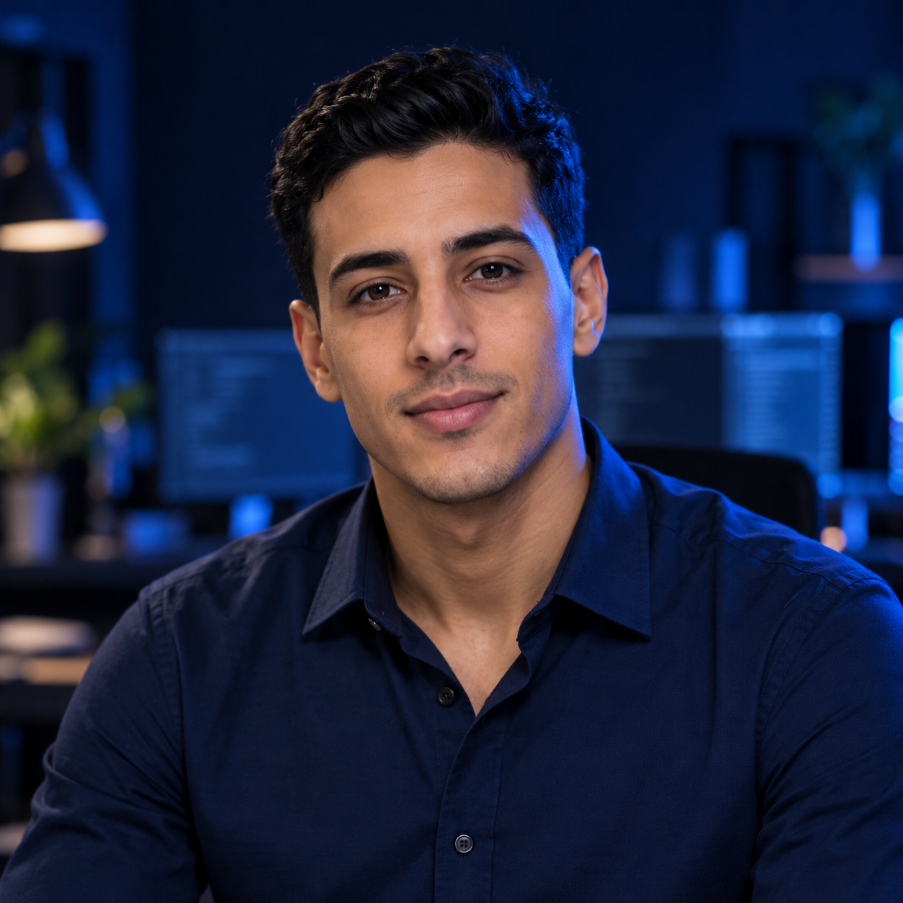
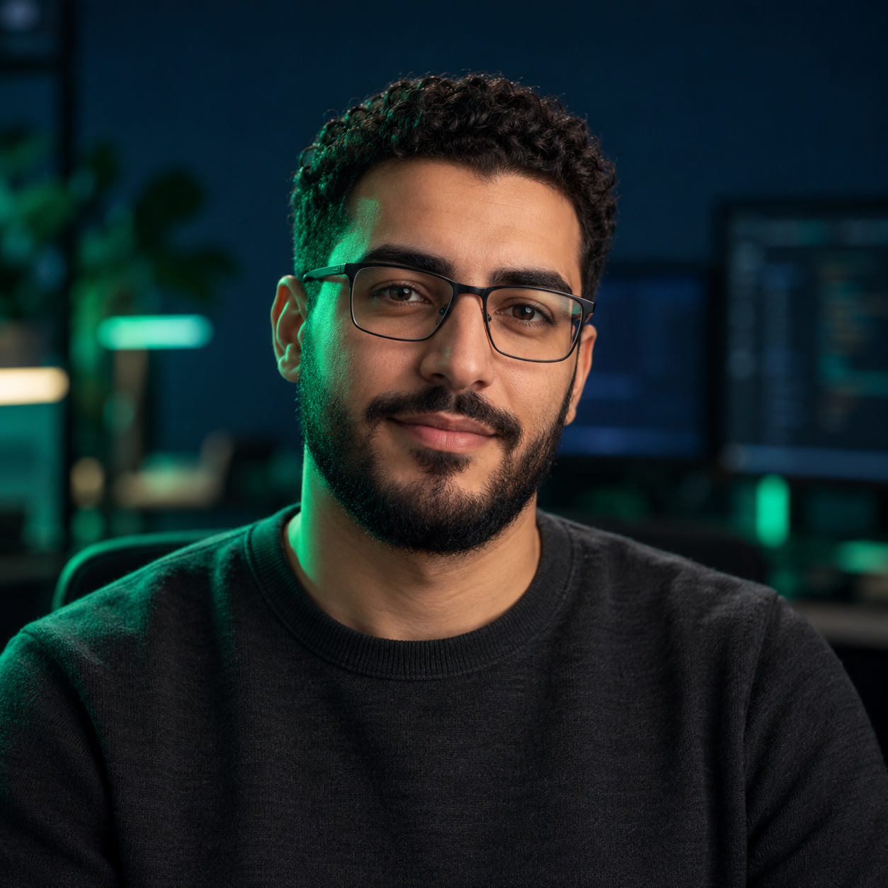
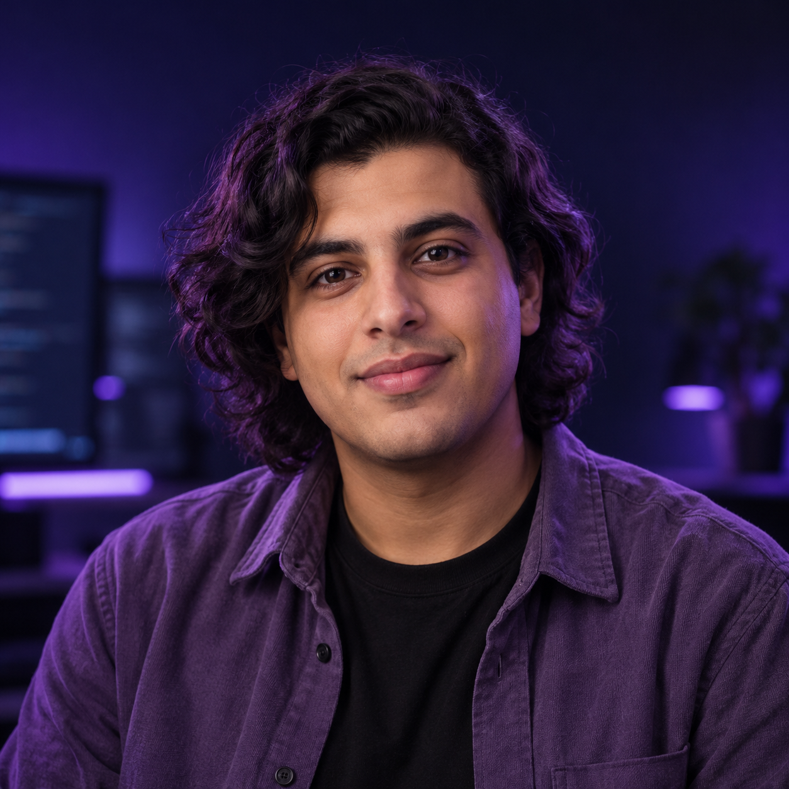
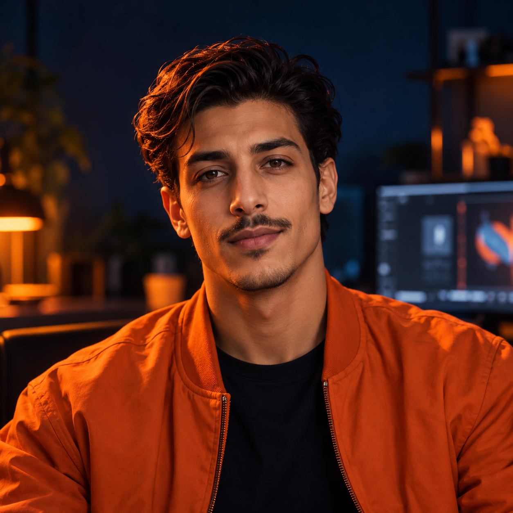

# 🎨 Team portraits

Four fictional AI identities generated for this project. Consistent square photographic style, navy backgrounds, coordinated lighting and distinct faces. Names and authoritative roles are supplied by the surrounding text, not embedded image text.

| Asset | Purpose | Format / dimensions | Used by | Verification |
| --- | --- | --- | --- | --- |
| [ayoube.png](ayoube.png) | Blue project coordinator | PNG, 1254 × 1254 | Ayoube identity | Visually inspected: centered crop, blue lighting, distinct face |
| [walid.png](walid.png) | Green software engineer | PNG, 1254 × 1254 | Walid identity | Visually inspected: glasses/beard, green lighting, readable crop |
| [annas.png](annas.png) | Violet QA specialist | PNG, 1254 × 1254 | Annas identity | Visually inspected: longer hair, violet lighting, no clipping |
| [reda.png](reda.png) | Orange creative director | PNG, 1254 × 1254 | Reda identity | Visually inspected: moustache/orange jacket, consistent framing |

## 🔵 Ayoube — organize and coordinate

## 🟢 Walid — engineer and explain

## 🟣 Annas — test and verify

## 🟠 Reda — design and create

These portraits establish visual identity; they are not teaching diagrams or proof of runtime provisioning. No native editable Figma/Canva design was produced.
