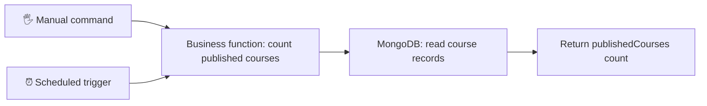
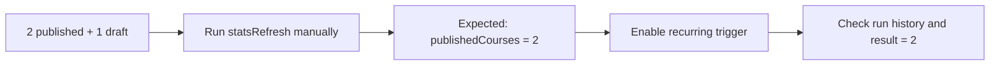

# ⏰ From a manual task to an automatic job

> 🎤 **Class walkthrough:** explain the idea first, then switch to the LMS for live coding.
>
> 🟡 **Preparation in progress.** Docker setup is verified. The real statistics function, manual command, scheduled result and rehearsal are still to be completed.

## 🎬 1. Open with a real problem

**Show:** this question before opening the code.

> “Our LMS needs updated statistics. Should someone click a button every night? We can automate that work. Today I’ll separate the work from its trigger, compare three architectures, and demonstrate one small job.”

**Our example:** count published courses. This is a small indicator calculation, not the full Brief 3 reporting feature. We will return the count; scheduled execution can store that result in the existing job history. We are not building a separate statistics dashboard.

**Ask colleagues:** “What should happen if the database is unavailable?”

## 🧠 2. Separate WHAT from WHEN



Both arrows call the **same function**. The manual command lets us test it immediately. The scheduler adds timing; it should not contain a duplicate calculation.

> “The business function defines what happens. The scheduler decides when to start it. I test the function manually before I automate it.”

## 🧭 3. Compare the three architectures


The outlined groups show which components share a container. Arrows show invocation and database access. The external example uses execution inside a running container; an external scheduler could instead launch a new container, with a different lifecycle.

| Location | Useful property | Limitation to explain |
| --- | --- | --- |
| Inside the API process | Small setup; fits the existing LMS scheduler | Stops with the API; multiple API instances may run the job twice |
| Separate worker process | Scheduling has its own lifecycle | Another process to operate; dependencies still matter |
| External scheduler | Trigger is outside the application | Needs a valid way to reach or launch the job |

> “For this demonstration, I choose the existing scheduler inside the API. It fits our current code and keeps the demo small. I would reconsider that choice if the job needed to keep running independently of the API.”

This is a proposed demo choice, not a claim that every architecture has been implemented or tested.

## 🔌 4. Show what independence really means


Read the chart with its assumptions: the worker and external job container remain running and the job reads MongoDB directly. A job that calls the API depends on the API too.

> “Independent from the API does not mean independent from every service. Our job still needs MongoDB.”

**Ask colleagues:** “If two API containers each have the scheduler, what could happen to reminder emails?” Expected reasoning: duplicate sends are possible without coordination.

## 🎯 5. Define the proof before coding

Use a controlled fixture **only in the practice database**. Planned fixture: two published courses and one draft course. The expected count is **2**, not 3. These are illustrative test records; they have not been inserted yet.



> “A start log only proves execution began. I compare the returned or recorded count with the known data. A success message with the wrong number is a failed check.”

| Evidence | What it tells us |
| --- | --- |
| START / `running` | The run began; outcome still unknown |
| SUCCESS with the expected result | The task reported completion and its result matches this fixture |
| FAILURE with the error | The run failed; investigate the recorded cause |
| No final state | Incomplete evidence; could be waiting, interrupted or unable to record its outcome |

Console logs and database history are different evidence. The current code stores run states in MongoDB but does not yet provide a complete start/success/failure console sequence. If MongoDB is unavailable, recording history there can also fail; console errors are still useful.

## 💻 6. Switch to the live coding

> “Now that we know the architecture and the expected result, let’s implement the smallest useful example.”

Open the **practice clone**, `C:/Users/LENOVO/Desktop/lms-scheduled-tasks-practice`.

| Step | File or action | Check before moving on |
| --- | --- | --- |
| 1 | Inspect `services/jobHandlers.js` | Identify `statsRefresh`; it currently returns a placeholder message |
| 2 | Implement the published-course count using `models/Course.js` | Return a clear `publishedCourses` number; keep other jobs unchanged |
| 3 | Add a small manual entry point | Connect to the practice DB, await the function, display the result, close the connection; report failures with a nonzero exit code |
| 4 | Prepare controlled sample courses | Verify two published and one draft in the practice DB |
| 5 | Run the manual entry point | Actual count equals 2 |
| 6 | Inspect `services/jobScheduler.js` and `models/NotificationConfig.js` | Understand enabled flag, frequency and handler registration |
| 7 | Enable only `statsRefresh` for the demo | Explicit schedule and timezone; apply configuration before registration or refresh/restart it |
| 8 | Observe automatic execution | Check timestamps, status and recorded count; no manual trigger during this observation |
| 9 | Explain a controlled API-stop scenario | Internal scheduler cannot launch runs while its API process is stopped; restore the practice API afterward |

**Timing plan:** use `* * * * *` (every minute) for a readable demo. `0 0 * * *` means daily at midnight in the scheduler's timezone. Use `Africa/Casablanca` explicitly when configuring the scheduler. The practice API has that `TZ` environment value; its scheduler currently has no explicit timezone option. Verify the actual behavior during implementation.

The manual entry point and its command are **planned**, not present yet. We will add the exact command after implementing and checking it. Do not claim the existing placeholder is a completed statistics job.

## 🐳 7. Docker commands for this practice copy

Run from the practice clone. Keep the explicit project/file arguments: its original Compose file uses the original LMS container names.

```powershell
# Inspect the practice stack.
docker compose -p lms-scheduling-practice -f compose.practice.yml ps

# Rebuild after source changes: there is no source bind mount.
docker compose -p lms-scheduling-practice -f compose.practice.yml up -d --build api

# Observe API output. Ctrl+C ends log following, not the containers.
docker compose -p lms-scheduling-practice -f compose.practice.yml logs -f api
```

| Practice service | Address |
| --- | --- |
| API | <http://localhost:3002/> |
| Swagger | <http://localhost:3002/api-docs> |
| MongoDB from the host | `mongodb://localhost:27019/lms_scheduling_practice` |
| MongoDB from the API container | `mongodb://mongo:27017/lms_scheduling_practice` |

**Verified on 26 October:** both practice containers running, MongoDB ping successful, API HTTP 200 from inside the container and host, and API connected to the isolated database. These checks verify setup, not scheduled statistics execution.

## 🚧 8. Explain the practical limitations

| Scenario | What to explain |
| --- | --- |
| API shutdown | Its internal scheduler stops |
| Restart | Startup registers configured schedules again; do not promise automatic recovery of missed runs |
| Multiple API instances | Independent schedulers can duplicate work |
| Slow job | A later trigger can overlap an earlier run without an appropriate policy |
| Retry | Design effects so repeating work does not create unwanted duplicates |
| MongoDB unavailable | The count and database-backed history may fail |

> “One worker does not magically solve overlap or retries. We still need to decide how repeated work is handled. For this demo, we verify one controlled path and explain these limits.”

## 🎤 9. Close with the evidence

After actual verification, explain what you observed: the known course fixture, manual count, scheduled timestamp, recorded result and the tested limitation. If a step fails, show the real error and state what remains unverified.

**Closing sentence to use after those checks pass:**

> “We separated the business function from the trigger, verified it manually, then verified one scheduled execution. We also identified what happens when the API stops and why dependencies still matter.”

## 📚 Sources and foundations

- Local *Eloquent JavaScript*, Chapter 11, printed pp. 185–186: asynchronous work and waiting. Docker and node-cron are separate tools, not topics taught on those pages.
- [node-cron cron syntax](https://www.nodecron.com/cron-syntax.html): five-field schedule examples.
- [node-cron scheduling options](https://www.nodecron.com/scheduling-options.html): timezone configuration. Check the installed version before using additional options.
- [Docker Compose exec](https://docs.docker.com/reference/cli/docker/compose/exec/): execution inside a running container.
- [Docker Compose quickstart](https://docs.docker.com/compose/gettingstarted/): startup, logs and rebuild workflow.
- [Existing concept lesson and image verification](./concepts/scheduler-locations/) · [Assignment](./README.md).

## ✅ Readiness checklist

- [x] Architecture diagrams and speaking sequence prepared.
- [x] Practice Docker environment checked.
- [ ] Real count implemented and checked manually.
- [ ] Scheduled result checked with explicit frequency/timezone.
- [ ] Console/history evidence and one limitation demonstrated.
- [ ] Rehearsed explaining while coding.

**Next:** rehearse sections 1–4 in your own words, then return to the first `statsRefresh` coding checkpoint.
