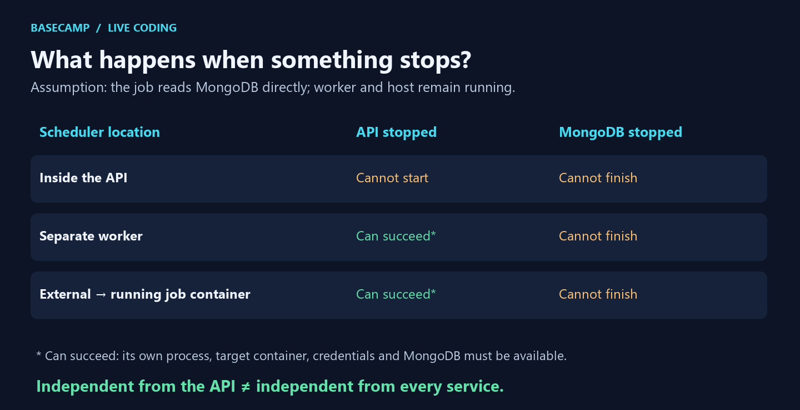

# 🧭 Where does the scheduler run?

> 🟡 **In progress** — verbal checks partly verified; independent explanation, implementation and rehearsal pending.

## 🧠 Same work, different starting points

The outlined group contains the scheduler and business function in the first two rows. Arrows mean starts, invokes, or accesses; MongoDB supplies the records. The external row shows one specific path: executing a command inside an already running job container. Other external designs can start a fresh container; they have different lifecycle requirements.

## 🧩 Independence and dependencies

These are illustrative scenarios, not runtime results. All jobs shown read MongoDB directly. A separate worker or job container can operate with the API stopped, provided its own dependencies remain available. A job that instead calls the API also depends on that API.

## ✅ Learner evidence — 26 October

- Correct: stopping the API stops a scheduler inside it.
- Correct: two API schedulers can cause duplicate reminder emails.
- Correct: a separate process need not stop with the API.
- Correct after clarification: this statistics job still needs MongoDB.
- Correct: an external scheduler cannot execute inside a stopped target container.
- Correct: external scheduling does not guarantee job success; MongoDB may be unavailable even when the trigger works.
- Pending: whole-architecture explanation, implementation and rehearsal.

## 🎤 Ready-to-say explanation

“We can schedule inside the API, in a separate process, or externally. Inside the API is simple, but stops with it and may duplicate work across instances. A separate process has its own lifecycle, but still depends on services such as MongoDB.”

## 📖 Book and MERN foundations

Chapter 11, printed pp. 185–186, consulted in the local PDF: asynchronous work and waiting. Docker scheduling architectures are not taught on those pages. Node.js executes our job; MongoDB supplies its records. React does not need to be running for these server-side examples.

## ⚠️ Remember

Starting a job does not prove success. A single worker also needs a policy for overlap, retries and duplicate effects; moving it does not automatically solve those problems.

Next checkpoint: distinguish job-start, success and failure logs; a start log alone is not proof of completion.

[Asset verification](./images/README.md) · [Manual trigger](../../notes/manual-trigger.md)
