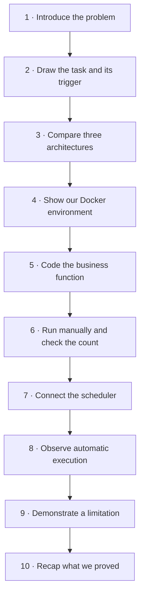
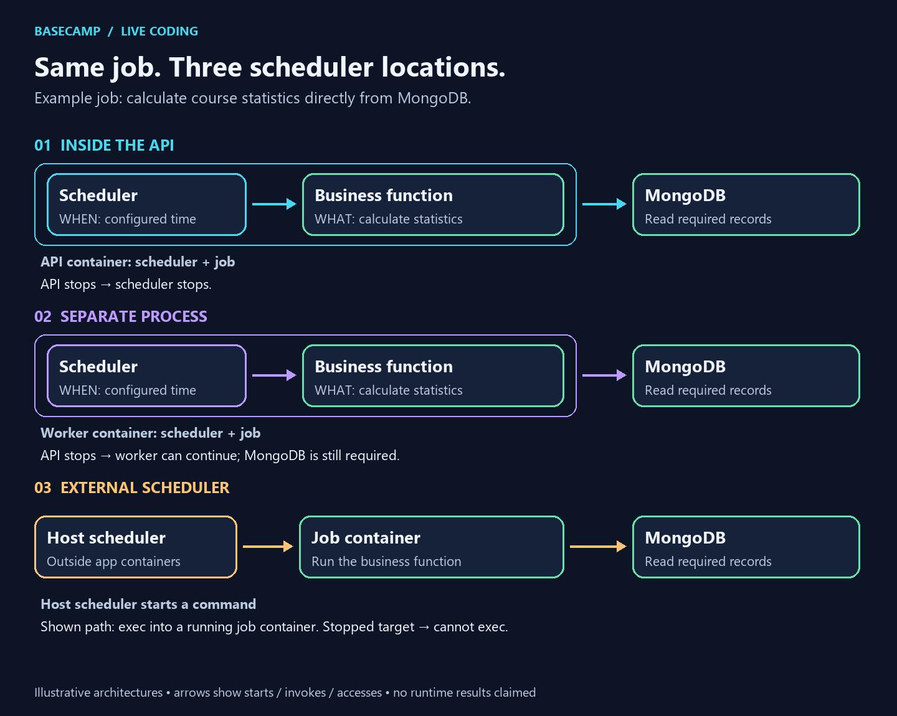
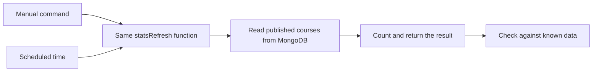

# 🎤 Our live-coding workflow

> **Today's question:** How can our Dockerized LMS run a task automatically?
>
> **Our example:** count published courses, first manually, then on a schedule.

## 🗺️ The route we will follow together

## 🚶 What students will see at each stop

| Stop | What I show or do | What students should understand |
| --- | --- | --- |
| **1. The problem** | Ask: “How do we update course statistics without someone clicking every time?” | Why a background job is useful |
| **2. The basic flow** | Draw **trigger → business function → MongoDB → result**; show that a manual command can call the same function | The task does the work; the scheduler starts it |
| **3. The architecture choice** | Show the three-location diagram below; choose the existing API scheduler for our small demo | API process, separate worker, and external scheduler are different options |
| **4. The environment** | Show the practice API and MongoDB containers; open the API on port 3002 | Where our code runs and where its data lives |
| **5. The business function** | Open `services/jobHandlers.js`; implement the count in `statsRefresh` using the `Course` model | The useful work exists independently of its schedule |
| **6. The manual check** | Prepare two published courses and one draft in the practice database; add and run a manual entry point | Expected count is **2**; we verify the calculation before automating it |
| **7. The scheduler** | Open `services/jobScheduler.js` and notification configuration; enable only our job; explain every-minute frequency and `Africa/Casablanca` timezone | How and when the same function gets called automatically |
| **8. The automatic proof** | Observe a scheduled run without manually triggering it; inspect timestamps, status and the count | A configured schedule is not proof: we need execution and the correct result |
| **9. The limitation** | Stop only the practice API, observe that its internal scheduler cannot launch jobs, then start it again | Scheduling inside the API shares its lifecycle; missed-run recovery must not be assumed |
| **10. The recap** | Trace the flow again; discuss duplicates across API instances, overlap and database failure | What the demonstration proves and what needs a stronger design later |

## 🖼️ The architecture picture to show at stop 3

Follow one row at a time. The outlined groups show what shares a container. The arrows show who starts the work and which database it needs. We compare all three approaches but implement **one** for this session.

## 🎙️ My opening

> “Today we’ll make a small LMS task run automatically. First, we’ll understand the flow and compare where scheduling can happen. Then we’ll write the task, verify it manually, connect a scheduler, and check the result. Finally, we’ll see what happens when the API stops.”

## 🔄 The flow students should remember

The manual runner will display the returned count. Scheduled execution will use the existing execution-history service to record its result. The calculation belongs in the function, not in two different triggers.

## ✅ Preparation status

- ✅ Isolated Docker practice environment checked.
- ✅ Architecture visuals and this session route prepared.
- 🟡 Coding, manual runner, sample records, automatic result and shutdown demonstration are planned; they still need implementation and rehearsal.

**Next preparation step:** implement and verify the business function at stop 5.

[Detailed speaker notes and practice commands](./WALKTHROUGH.md) · [Assignment](./README.md)
