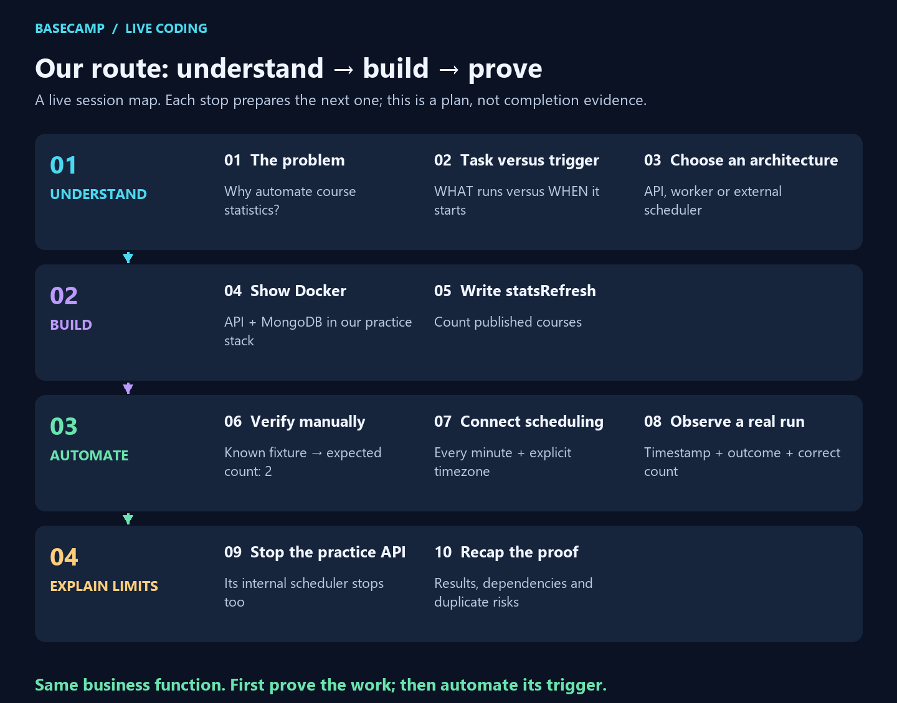
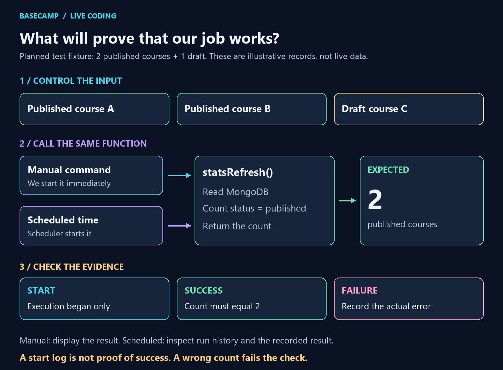

# ⏰ From a manual task to an automatic job

<strong>UNDERSTAND 🧠 → BUILD 💻 → AUTOMATE ⏰ → VERIFY 🔎</strong>

> **Today's question:** How can our Dockerized LMS run a task automatically?
>
> **Our example:** count published courses, first manually, then on a schedule.

## 🗺️ The route we will follow together

**Read from top to bottom.** Each numbered stop prepares the next one. We verify the calculation before adding scheduling, then finish by explaining a limitation. This is the planned session route, not a completion chart.

| Phase | Stops | The question we answer |
| --- | --- | --- |
| 🟦 **Understand** | 1–3 | What runs, what starts it, and where should scheduling live? |
| 🟪 **Build** | 4–5 | Where does the code run, and what useful work will it do? |
| 🟩 **Automate** | 6–8 | Does it work manually, and can we prove automatic execution? |
| 🟧 **Explain limits** | 9–10 | What happens when the API stops, and what did we actually prove? |

## 🚶 What students will see at each stop

| Stop | What I show or do | What students should understand |
| --- | --- | --- |
| **1. The problem** | Ask: “How do we update course statistics without someone clicking every time?” | Why a background job is useful |
| **2. The basic flow** | Draw **trigger → business function → MongoDB → result**; show that a manual command can call the same function | The task does the work; the scheduler starts it |
| **3. The architecture choice** | Show the three-location diagram below; choose the existing API scheduler for our small demo | API process, separate worker, and external scheduler are different options |
| **4. The environment** | Show the practice API and MongoDB containers; open the API on port 3002 | Where our code runs and where its data lives |
| **5. The business function** | Open `services/jobHandlers.js`; implement the count in `statsRefresh` using the `Course` model | The useful work exists independently of its schedule |
| **6. The manual check** | Prepare two published courses and one draft in the practice database; add and run a manual entry point | Expected count is **2**; we verify the calculation before automating it |
| **7. The scheduler** | Open `services/jobScheduler.js` and notification configuration; enable only our job; explain every-minute frequency and `Africa/Casablanca` timezone | How and when the same function gets called automatically |
| **8. The automatic proof** | Observe a scheduled run without manually triggering it; inspect timestamps, status and the count | A configured schedule is not proof: we need execution and the correct result |
| **9. The limitation** | Stop only the practice API, observe that its internal scheduler cannot launch jobs, then start it again | Scheduling inside the API shares its lifecycle; missed-run recovery must not be assumed |
| **10. The recap** | Trace the flow again; discuss duplicates across API instances, overlap and database failure | What the demonstration proves and what needs a stronger design later |

## 🖼️ The architecture picture to show at stop 3

Follow one row at a time. The outlined groups show what shares a container. The arrows show who starts the work and which database it needs. We compare all three approaches but implement **one** for this session.

| Architecture | Useful property | Main limitation |
| --- | --- | --- |
| 🟦 **Inside the API** | Small setup; reuses our existing scheduler | Stops with the API; multiple API instances can duplicate runs |
| 🟪 **Separate worker** | Its lifecycle is independent of the API | Another process to manage; MongoDB is still required |
| 🟧 **External scheduler** | Trigger lives outside the application | Must reach a running target or explicitly launch a new one |

> 🎯 **Our demo choice: inside the API.** It fits the current LMS structure and keeps our first demonstration small. A job requiring an independent lifecycle may need a different choice.

## 🎙️ My opening

> “Today we’ll make a small LMS task run automatically. First, we’ll understand the flow and compare where scheduling can happen. Then we’ll write the task, verify it manually, connect a scheduler, and check the result. Finally, we’ll see what happens when the API stops.”

## 🔄 The flow students should remember

**Read in three steps:** control the input, call the same function, check the evidence. The three course records are a **planned fixture**, not records already inserted or a measured result.

The manual runner will display the returned count. Scheduled execution will use the existing execution-history service to record its result. The calculation belongs in the function, not in two different triggers.

## 🔎 What proves the demonstration worked?

| Check | Pass condition | Insufficient evidence |
| --- | --- | --- |
| 🖐️ **Manual calculation** | Returns `publishedCourses: 2` for the fixture | A start message or a wrong count |
| ⏰ **Automatic execution** | A run occurs at the configured time without a manual trigger | A saved frequency with no observed run |
| 📋 **Scheduled result** | Recorded successful outcome and count equal to **2** | START alone, failure, wrong count or no final state |
| 🛑 **API-stop limitation** | No new internal scheduler run starts while its process is stopped | Assuming it keeps running or recovers every missed run |

> ⚠️ **A start message proves a beginning. Check the actual result before claiming success.** Console logs and database history are different evidence; history recording can also fail when MongoDB is unavailable.

## 🚧 What can go wrong?

| Situation | Effect | Point to explain |
| --- | --- | --- |
| API stops | Its internal scheduler stops | Shared process means shared lifecycle |
| MongoDB stops | This database-dependent job cannot finish successfully | An independent scheduler still has dependencies |
| Two API schedulers run | Both may perform the same job | Coordinate execution and avoid unwanted duplicate effects |
| Job takes longer than its interval | Runs may overlap | Decide how concurrent runs should be handled |
| API restarts | Startup registers schedules again | Do not assume recovery of missed runs |

## ✅ Preparation status

- ✅ Isolated Docker practice environment checked.
- ✅ Architecture visuals and this session route prepared.
- 🟡 Coding, manual runner, sample records, automatic result and shutdown demonstration are planned; they still need implementation and rehearsal.

**Next preparation step:** implement and verify the business function at stop 5.

> 🎤 **Remember:** “Build the work, verify it manually, automate its trigger, then check the real result.”

[🎙️ Detailed speaker notes and practice commands](./WALKTHROUGH.md) · [📋 Assignment](./README.md) · [🖼️ Visual sources and checks](./images/README.md)
