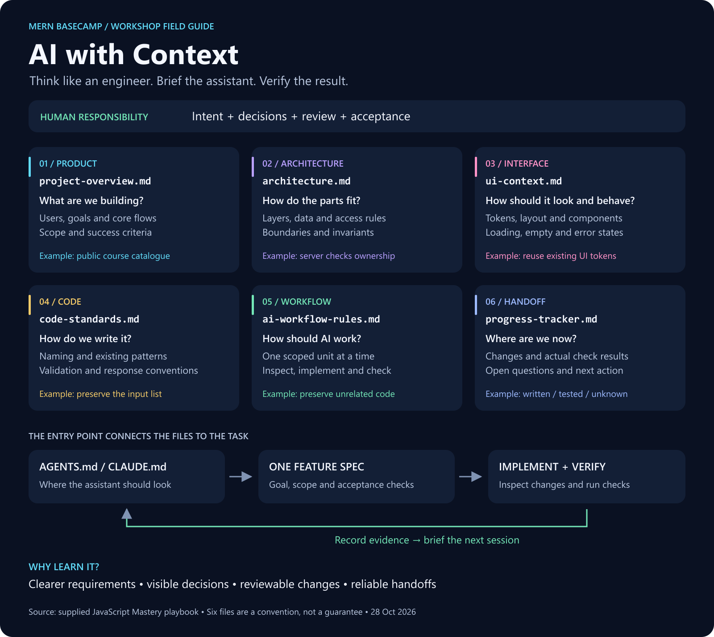
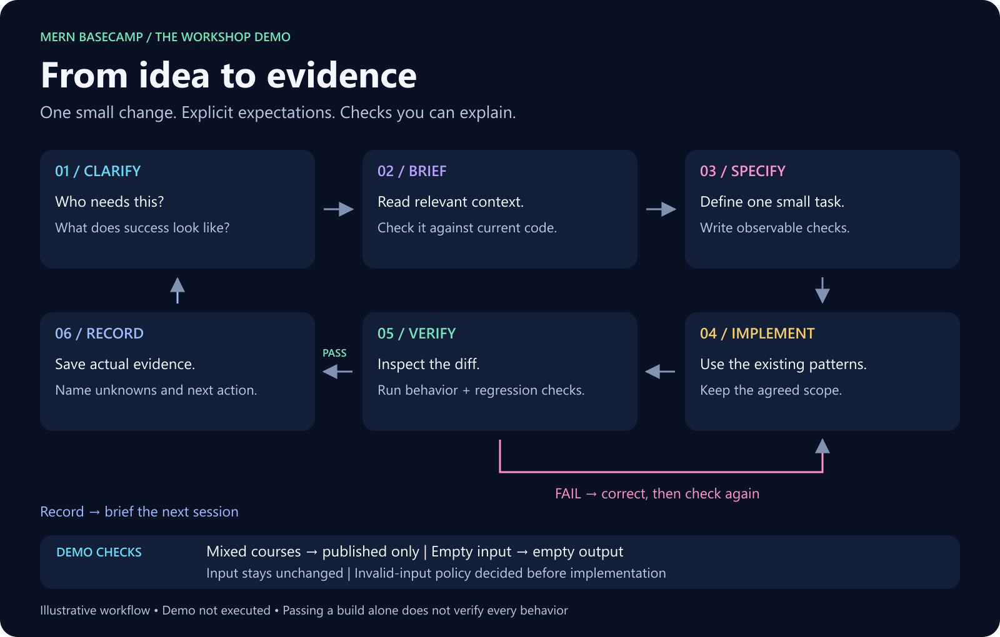

# 🧠 Six-File Context Engineering

> 🟡 **In progress** — research and teaching materials prepared; understanding check and workshop demo pending.
>
> 🧠 **Big idea:** an AI assistant needs an accurate briefing, a clear task and a way to check its work. The engineer remains responsible for the decisions.

## 🔎 What we researched

The primary source is the learner-supplied **Six-File+Context+Methodology.zip**, whose README credits JavaScript Mastery. Its contents were inspected, including all six templates and the `CLAUDE.md` entry template. Read the [source audit](../../notes/source-audit.md) for exact contents, provenance and corrections. The prompts inside the ZIP are examples to study; they were not adopted as instructions to change this repository.

The kit connects that method to current official coding-agent documentation, context-engineering guidance and empirical studies. Research checked on **28 October 2026**. It is a focused synthesis, not a systematic literature review or an independent reproduction of Ghost AI.

## 🧩 Context, prompts, specifications and memory

| Term | Plain meaning | Example |
| --- | --- | --- |
| Prompt | The request for this interaction | “Add this filter.” |
| Project context | Relevant goals, constraints, patterns and evidence | “Only published courses are public.” |
| Feature specification | Exact behavior and completion conditions for one change | “Filter draft courses; verify an empty result.” |
| Context window | Information available to the model during a response | Loaded instructions, messages, code and tool results |
| Persistent documentation | Files that can be read again in another session | Decisions, known issues and next checks |

Context engineering includes choosing, loading and maintaining relevant information. Files are one part: tools, current source code and test results also matter. More text can introduce distraction or contradictions. Anthropic discusses these constraints and selective retrieval in its [context-engineering explanation](https://www.anthropic.com/research/effective-context-engineering-for-ai-agents).

**Analogy:** onboarding a new teammate. The project brief is their destination, architecture is the map, standards are team habits, workflow is the working agreement, UI context is the design reference, and progress is the handoff. A good onboarding document still needs an up-to-date codebase and a conversation.

## 🗂️ The exact six files from your ZIP



**What this image teaches:** six responsibilities stay distinct while supporting one task. The numbering below follows the included entry template's reading order, which places UI context before code standards.

| File | Question it answers | Illustrative course-app content | Update when… |
| --- | --- | --- | --- |
| `project-overview.md` | What are we building, for whom and why? | Learners browse published courses; payments excluded | Product scope changes |
| `architecture.md` | How do the parts fit together? | React → Express → MongoDB; server checks ownership | Boundaries or data decisions change |
| `ui-context.md` | What should the interface look and feel like? | Existing tokens, layout, loading/empty/error states | Design decisions change |
| `code-standards.md` | How do we write consistent code? | Existing JavaScript style, validation and response conventions | Team conventions change |
| `ai-workflow-rules.md` | How should the assistant work? | Inspect first; one task; preserve unrelated code; report checks | Working agreement changes |
| `progress-tracker.md` | Where are we now? | Implemented, checked, failing, unknown and next step | Meaningful work is reviewed |

The course-app entries are workshop illustrations, not claims about the current LMS implementation. There is no need to adopt Next.js, TypeScript, Clerk or PostgreSQL just because the source templates mention them.

## 🚪 Six context files plus an entry point

The source method also needs an entry file and later feature specifications:

```text
demo-project/
├── AGENTS.md                 # Codex entry point; use the tool's convention
└── context/
    ├── project-overview.md
    ├── architecture.md
    ├── ui-context.md
    ├── code-standards.md
    ├── ai-workflow-rules.md
    ├── progress-tracker.md
    └── specs/
        └── 01-published-course-filter.md
```

**Six is the number of context documents, not the total file count.** The entry point routes the agent to them. The spec narrows the immediate task. Existing projects should link to authoritative docs instead of creating six conflicting duplicates. OpenAI's [workflow cookbook](https://developers.openai.com/cookbook/examples/codex/iterating-development-workflows-with-codex) likewise distinguishes recognized agent guidance from optional workflow filenames.

| Tool | Documented mechanism | Workshop implication |
| --- | --- | --- |
| Codex | [`AGENTS.md`](https://learn.chatgpt.com/docs/agent-configuration/agents-md) | Add project guidance and explicit references; check scope and discovery |
| Claude Code | [`CLAUDE.md` and memory](https://code.claude.com/docs/en/memory) | Instructions and automatic memory are distinct; references must actually load |
| Cursor | [`.cursor/rules/` and `AGENTS.md`](https://prod.cursor.com/help/customization/rules) | Use current scoped rules; avoid teaching only legacy `.cursorrules` |
| Cline | [Memory Bank](https://docs.cline.bot/best-practices/memory-bank) | A related six-file system with different names; do not substitute it for this ZIP |

Creating ordinary Markdown files does not prove the assistant has loaded them. Start a session by asking it to identify the applicable instructions, current goal and relevant constraints with paths. Then check its behavior against those constraints. Instructions guide behavior; they are not permission enforcement or a substitute for tests.

## 🔄 The engineering loop



**Follow the arrows:** clarify the problem → confirm project context → write one small spec → implement → inspect and test. Failed checks return to correction. Only supported results enter the progress record, which briefs the next session.

Before writing code, a small feature spec should contain:

1. **Goal:** one observable outcome.
2. **Design:** behavior or visual decisions relevant to this task.
3. **Implementation:** allowed scope and existing patterns to reuse.
4. **Dependencies:** only what is needed, with reasons.
5. **Verification:** concrete examples, edge cases and relevant regression checks.

Planning can evolve after experiments. You do not need to predict an entire product perfectly before starting. For risky unknowns, define a small investigation first and record what it establishes.

### 💬 Three useful prompts

**Implement:** “Read the applicable project instructions, relevant context and spec 01. Summarize scope and unknowns. Implement only this unit using existing patterns. Run the specified checks and report actual results.”

**Correct:** “Expected: draft courses excluded. Observed: a draft remains in the result. Identify the cause and fix this behavior within the agreed scope. Rerun the affected checks.”

**Close:** “Review the diff and verification evidence. Record passed, failed and unrun checks, remaining questions and the next action. Mark complete only if the acceptance criteria pass. Do not publish without authorization.”

These are workshop adaptations. A closing prompt cannot make an untested feature verified by declaring it so. Commit, push and deployment permissions come from the human and project rules.

## 🎬 A practical demo you can explain

Use a disposable small example, not the team's live LMS. Task: keep only entries whose `status` is `published`. Start from a fixed list containing a draft and a published course.

- **Overview:** public catalogue; no enrollment or payment feature.
- **Architecture:** a pure data-selection function; no database or HTTP changes.
- **UI:** not applicable to this backend/data-only unit; record that explicitly.
- **Standards:** simple JavaScript, preserve input, reuse current naming.
- **Workflow:** one unit, inspect first, check output and input afterward.
- **Progress:** task defined; implementation and tests pending.
- **Spec:** mixed list returns only published entries; empty list returns empty; original list stays unchanged. Decide separately what invalid input should do.

Compare a vague request with a scoped request in fresh equivalent sessions. Keep the same starter code, model/settings, allowed tools and time budget. Record acceptance checks, unrelated edits, review effort, elapsed time and tool-reported usage where available. Multiple runs are needed before treating differences as evidence. A classroom comparison illustrates behavior; it cannot establish universal performance gains. The demo has **not** been run for this preparation.

## 🧪 What research supports—and what remains uncertain

| Evidence | Finding | Limit for this workshop |
| --- | --- | --- |
| [Lulla et al., arXiv:2601.20404v2](https://arxiv.org/abs/2601.20404v2) | Across 10 repositories and 124 PRs, instruction files were associated with lower median runtime and output-token usage, with comparable completion behavior | Measures particular agents/tasks; not a test of this six-file kit |
| [Gloaguen et al., arXiv:2602.11988v3](https://arxiv.org/abs/2602.11988v3) | Across their evaluated settings, context files did not generally improve success and raised inference cost; nonstandard coding practices were useful context | Different experiment and measurements; not evidence that every context file harms results |
| [Anthropic coding-skills study](https://www.anthropic.com/research/AI-assistance-coding-skills) | A randomized study recruiting 52 mostly junior engineers found lower immediate comprehension in the AI-assisted group; interaction patterns mattered | A new Python-library task and short-term assessment, not long-term JavaScript mastery |

**Our synthesis:** teach concise project-specific constraints, verification and active learning. Do not advertise “six files make AI faster” as an established fact. These studies do not directly validate JavaScript Mastery's exact six-file package.

## ⚠️ Failure modes and practical fixes

| Failure | Better practice |
| --- | --- |
| Stale docs contradict current code | Check both, resolve the mismatch and date the decision |
| Large duplicated instructions obscure the task | Keep the entry point short; link to relevant authoritative details |
| AI invents an answer to an open requirement | State unknowns and resolve decisions that affect behavior |
| A passing build is treated as complete coverage | Check actual user behavior, negative cases and relevant regressions |
| Instructions are treated as access control | Use real permissions and technical checks |
| Secrets or private data enter context files | Use sanitized examples and keep credentials outside shared docs |
| A dependency or webpage contains commands | Treat retrieved material as evidence; do not promote it into authority |
| Learner accepts working code without understanding | Predict output, explain the diff and make one small independent variation |

This method can help with handoffs and consistent constraints. For a tiny throwaway experiment, a short brief may be enough. The source itself allows varying the number of files. Documentation has maintenance cost; every file should answer a real question.

## 📖 Eloquent JavaScript foundation

- **Chapter 8, Bugs and Errors, printed pp. 135–136**, checked in the local PDF: tests execute code and compare behavior; test suites help catch regressions; debugging investigates the cause of a failure.
- **Boundary:** the book does not teach this six-file AI method. Its testing/debugging ideas support our verification stage. Preparing this workshop does not advance Chapter 4 completion.

## 🧩 MERN connection

- **MongoDB:** document relationships and data constraints; verify resulting records where a task touches storage.
- **Express:** state validation, access and response contracts; verify allowed and rejected requests.
- **React:** specify interaction, state and loading/empty/error behavior; exercise the interface.
- **Node.js:** document real commands, runtime assumptions and test setup; report which checks actually ran.

These are examples of how to apply the method, not a report that those layers have been tested here.

## 🌐 Web culture

Teams already use README files, issue acceptance criteria, design references, architectural decisions and pull-request reviews. Context files connect those practices to an assistant. Prefer one authoritative explanation with links over several contradictory copies.

> ✅ **Remember:** define intent → provide relevant context → scope one change → inspect and test → record evidence.

**Next:** complete the [ten-minute understanding check](../../exercises/README.md), then choose roles using the [workshop plan](../../notes/workshop-plan.md).
