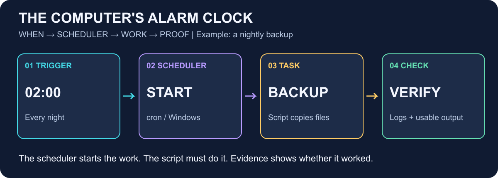
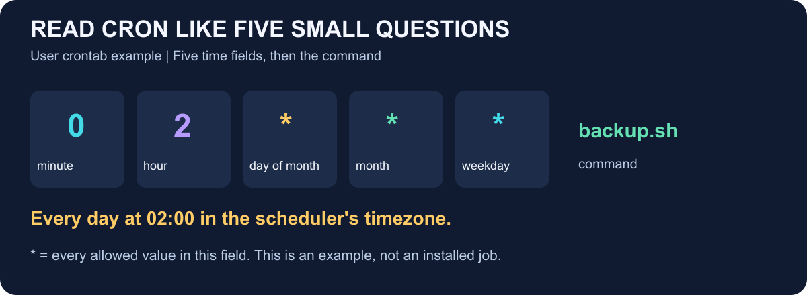
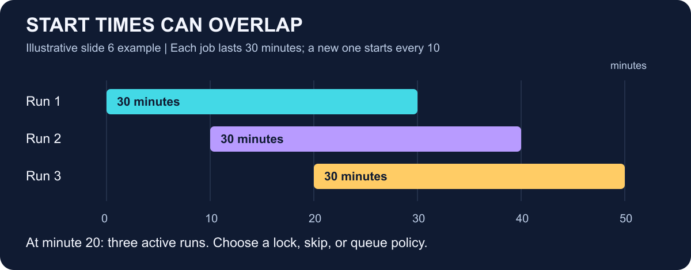

# ⏰ Task scheduling — the computer's alarm clock

> 🟡 **In progress:** first-pass study guide for **20 October 2026**, based on the eight-slide *Planification des tâches* deck read on 19 October. Understanding and rehearsal are still unchecked.

## 🎯 The whole idea in 30 seconds

Imagine a school caretaker who gets this instruction: **“Every night at 2, back up the school files.”** Nobody needs to click a button. The caretaker checks the time, starts the backup, then checks the result.

In a computer, the **scheduler** plays that caretaker's role. It decides **when to start** a script; the **script** does the actual work.

**Remember: WHEN → SCHEDULER → WORK → PROOF.**

The arrows show the launch flow. The final panel reminds you that starting a program does not prove that its backup is usable.

## 🎤 Your presentation story

The deck names **Mehdi Karbitou and Chahed Mazouz**. Its notes assign Member A slides 1–4 (about four minutes), then Member B slides 5–8. These are the deck's instructions; no rehearsal or delivery is recorded.

| Slide | Plain-English meaning | Memory cue |
| --- | --- | --- |
| 1 — Planification des tâches | A computer can start work automatically. Open with a nightly backup. | Who clicks at 2 AM? Nobody. |
| 2 — Planifier : lancer sans intervention | A trigger tells the scheduler when to launch a task. Check its result. | When → launcher → work → proof |
| 3 — Trois façons de déclencher | Once, repeatedly, or after an event. | Once / again / something happened |
| 4 — cron et Planificateur de tâches | Linux and Windows offer tools for scheduling. | Same idea, different tools |
| 5 — Contexte d'exécution | The scheduler may use another account, folder, environment, or timezone. | Where and as whom? |
| 6 — Trois cas problématiques | A run can be missed, overlap another run, or be affected by clock changes. | Off / busy / clock change |
| 7 — Savoir si une tâche a réussi | Check exit status, logs, real output, and alerts. | Started ≠ succeeded |
| 8 — Sources | Show where the claims come from and open discussion. | Explain, then answer |

## 🧭 First understand your four slides

### 1. Why do we need this?

People forget repetitive jobs. A scheduler can launch backups, clean temporary files, or send planned reminders. The machine or service running the scheduler must be available; a powered-off laptop cannot execute a local job.

### 2. Learn just five words

| French slide term | English | Think of it as… |
| --- | --- | --- |
| Tâche | Task / job | The work: make a backup |
| Déclencheur | Trigger | The signal: it is 2 AM |
| Fréquence | Frequency | How often: every night |
| Ordonnanceur | Scheduler | The service that starts the work |
| Contexte d'exécution | Execution context | Account, folder, permissions, environment, timezone |

The scheduler does not automatically write the backup code, repair errors, or verify the business result. Those need deliberate configuration and task logic.

### 3. Three trigger families

| Family | Example | What makes it start? |
| --- | --- | --- |
| One-off — ponctuelle | One reminder on 25 October at 9 AM | One date and time |
| Recurring — périodique | Backup every night at 2 AM | A repeated schedule |
| Event-based — sur événement | Create a thumbnail after an image arrives | An observed event |

An event needs a mechanism that detects it. Basic cron time expressions do not watch arbitrary file uploads. Windows supports time and event triggers; an application's upload handler or a worker can also react to an upload.

### 4. Two tools, one principle

- **Linux cron:** a background service checks schedule entries each minute and launches matching commands.
- **Windows Task Scheduler:** configure a trigger, an action, the account, and settings.
- **crontab:** the schedule table; **cron:** the service using it. They are related, but not the same thing.

Read `0 2 * * * backup.sh` as **“start backup.sh every day at 02:00 in the scheduler's timezone.”** The five fields are minute, hour, day of month, month, weekday. `*` accepts every value for its field. `backup.sh` is an illustrative command, not an existing script in this repo; real configuration needs a valid command and suitable paths and permissions.

## 🛟 Understand Chahed's half without memorizing everything

- **Different context:** “It works in my terminal” can fail under a scheduler because its account, working folder, PATH, or permissions differ. Use explicit paths and verify the actual environment.
- **Missed run:** ordinary cron does not replay every run missed while the machine was off. Catch-up depends on the tool and configuration. A one-off task is not universally lost when missed.
- **Overlap:** if work lasts 30 minutes and starts every 10 minutes, multiple runs can coexist. Use a lock or an explicit policy: skip, queue, or allow concurrent runs.
- **Timezone:** say which timezone defines “2 AM.” Clock-change behavior varies by implementation; an explicit local timezone alone does not remove skipped or repeated local times. UTC avoids daylight-saving jumps but changes the local-time relationship.
- **Idempotence:** retrying the **same operation** should not duplicate its intended effect. Marking reminder `R42` as sent once can prevent duplicate sends; blindly sending a new email on every retry cannot.
- **Proof:** conventionally exit code `0` reports success; logs explain what happened. Also inspect the expected output. A non-empty backup is only a first check; restoring it is stronger evidence.

Each colored lane is one run. At minute 20, all three are active. The times come from slide 6's teaching example, **not measured performance**. A schedule controls start times; it does not guarantee that the previous run has finished.

## 🧩 How this connects to your MERN work

Imagine a weekly LMS reminder: a scheduler starts a **Node.js** script; the script reads eligible learners from **MongoDB**, performs the reminder work, and records its outcome. **Express** may expose configuration or run history. This is an illustrative design, not verified LMS behavior. React is not needed to understand this scheduling flow.

Scheduling answers **“when should work start?”** Asynchronous JavaScript answers **“how can a running program handle waiting?”** A timer inside a running process is not automatically a durable scheduler that survives shutdown.

## 📖 Eloquent JavaScript foundation

Consulted the local PDF: Chapter 11, **Asynchronous Programming**, printed **pp. 185–186**, explains work and waiting; Chapter 20, **Node.js**, printed **pp. 361–362**, introduces scripts outside the browser, the `node` command, and exit status. These foundations explain what a scheduled JavaScript job could run. The book pages do **not** teach cron or Windows Task Scheduler.

## ⚠️ Small corrections to remember

1. Cron checks entries each minute; it does not necessarily reread every unchanged table from disk each minute.
2. Missed-run recovery depends on scheduler settings, not just “one-off versus recurring.”
3. A scheduler launching a task, a zero exit code, and a usable output are different pieces of evidence.

## 🚀 One small check before tomorrow

Without looking above, explain the nightly backup in **30 seconds**: identify its trigger, scheduler, task, and one way to check success. Then use the [three-question check](exercises/README.md). We will review your explanation before calling the concept understood.

## 🔎 Review navigation and sources

- [Quick review note](notes/task-scheduling.md) · [Notes index](notes/README.md)
- [Concept index](concepts/README.md) · [Concept checkpoint](concepts/task-scheduling/README.md)
- [Source and slide analysis](notes/deck-analysis.md) · [Visual verification](concepts/task-scheduling/images/README.md)
- [Original shared presentation](https://onedrive.live.com/:p:/g/personal/ad0e3ea6ebff7779/IQCz3gJULSBXSJqaLzuBkIBkAQvGdx7QvAd5WuGU7JE1zUY)
- [Cronie crontab manual](https://www.mankier.com/5/crontab) — fields, environment, minute checks; clock-change details depend on implementation.
- [Microsoft task components](https://learn.microsoft.com/en-us/windows/win32/taskschd/tasks) — triggers, actions, account, settings.

The original deck was read online, including speaker notes. It was not modified or downloaded. This guide is a companion, not a replacement deck.
