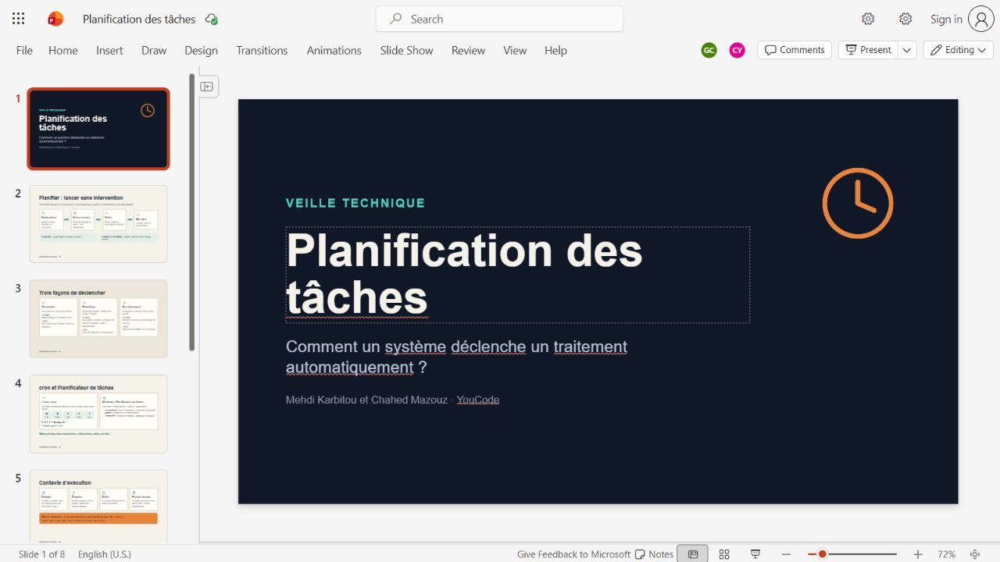
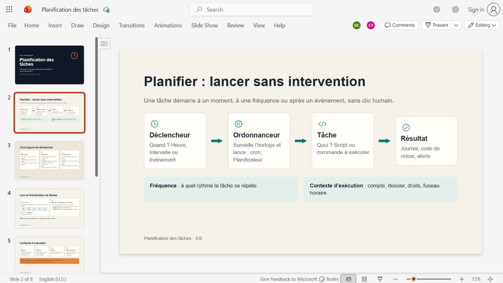
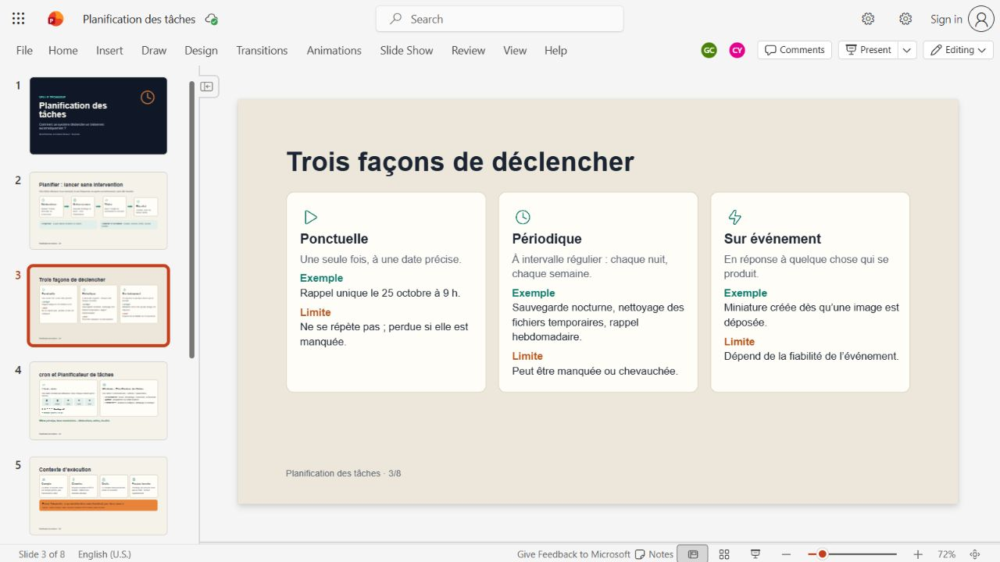
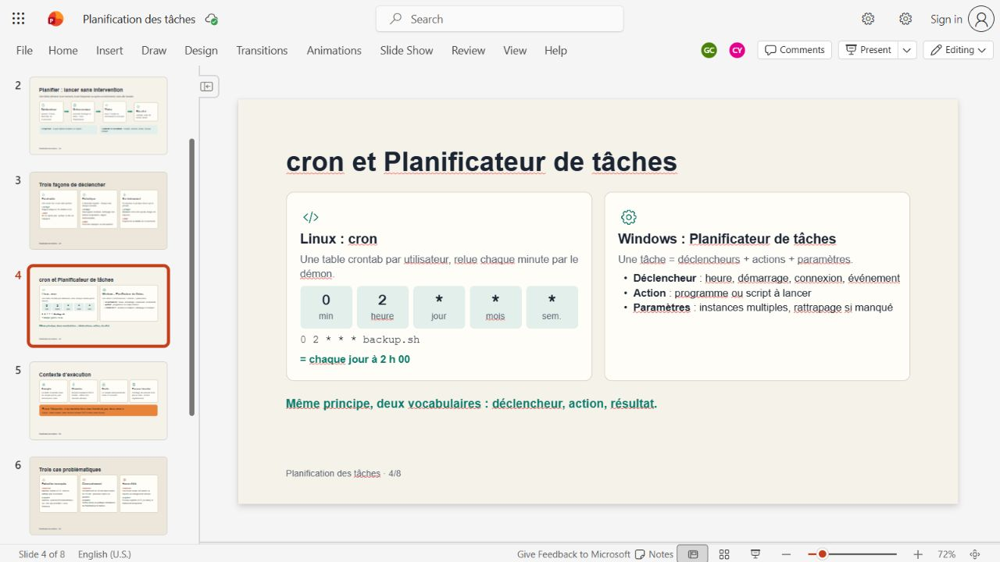

# 🎤 Your first four slides — understand the story

🟡 **In progress:** original slide images saved; explanation and rehearsal not yet checked with the learner.

These are screenshots of the actual shared PowerPoint, captured on 19 October 2026. They include the editor around each slide. The editable PowerPoint download did not return an accessible file; this is an image archive, not a `.pptx` export. [Original deck](https://onedrive.live.com/:p:/g/personal/ad0e3ea6ebff7779/IQCz3gJULSBXSJqaLzuBkIBkAQvGdx7QvAd5WuGU7JE1zUY).

## ⏰ Slide 1 — Planification des tâches



**Idea:** computers can start jobs automatically. Imagine a backup every night at 2 AM: nobody has to wake up and click “Start.” You choose the rule beforehand, and the scheduler starts the work when the rule matches.

**Remember:** automatic work starts from a rule.

**Transition:** “So, what happens between the planned time and the actual work?”

## 🔗 Slide 2 — Planifier : lancer sans intervention



Follow the arrows with the same backup example:

1. **Déclencheur / trigger:** it is 2 AM — this answers **when**.
2. **Ordonnanceur / scheduler:** cron or Windows Task Scheduler starts the job.
3. **Tâche / task:** the backup script copies the files — this answers **what**.
4. **Résultat / result:** check the logs, exit status, and expected backup output.

**Fréquence** means how often, such as every night. **Contexte d'exécution** means the account, folder, permissions, environment, and timezone the job uses.

**Remember:** the scheduler launches; the script works; evidence tells us what happened.

**Transition:** “A task can start in three different ways.”

## 🎯 Slide 3 — Trois façons de déclencher



| Trigger | Simple meaning | Example |
| --- | --- | --- |
| **Ponctuelle** | Once at a chosen time | One reminder on 25 October at 9 AM |
| **Périodique** | Repeatedly | A backup every night |
| **Sur événement** | When something happens | Create a thumbnail after an image upload |

**Remember:** once, again and again, or because something happened.

**Accuracy note:** the original slide says a missed one-off run is lost. That depends on the tool and catch-up settings. A recurring run can also be missed or overlap another run. Events need reliable detection; ordinary cron time expressions do not monitor arbitrary uploads.

**Transition:** “Now let's look at two tools that put this idea into practice.”

## 🛠️ Slide 4 — cron et Planificateur de tâches



**Linux:** cron is a background scheduling service. Its schedule entries are stored in a **crontab**. It checks which entries match the current minute and starts their commands.

```text
0     2     *              *       *          backup.sh
minute hour day-of-month   month   weekday    command
```

This means **run backup.sh every day at 02:00 in the scheduler's timezone**. The stars accept every value for their fields. The command is illustrative; no backup script or job has been installed here.

**Windows:** Task Scheduler uses a graphical interface where you choose the **trigger**, **action**, and **settings**, including rules for overlapping or missed runs.

**Accuracy note:** say “cron checks entries each minute”; it need not reread every unchanged table from disk every minute.

**Remember:** two tools, the same basic idea: choose when, choose the work, and check the outcome.

**Handoff to Chahed:** “We now know how tasks start automatically. Chahed will explain what can go wrong and how we check that they succeeded.”

## 📖 Foundation and next step

The [main guide](../README.md#-eloquent-javascript-foundation) connects this topic to the consulted local book: Chapter 11, printed pp. 185–186, and Chapter 20, printed pp. 361–362. Cron and Windows Task Scheduler are external tools, not topics taught by those pages.

**One next action:** explain slide 2 using the nightly backup, without looking at the labels. [Understanding check](../exercises/README.md) · [Image verification](images/README.md).
