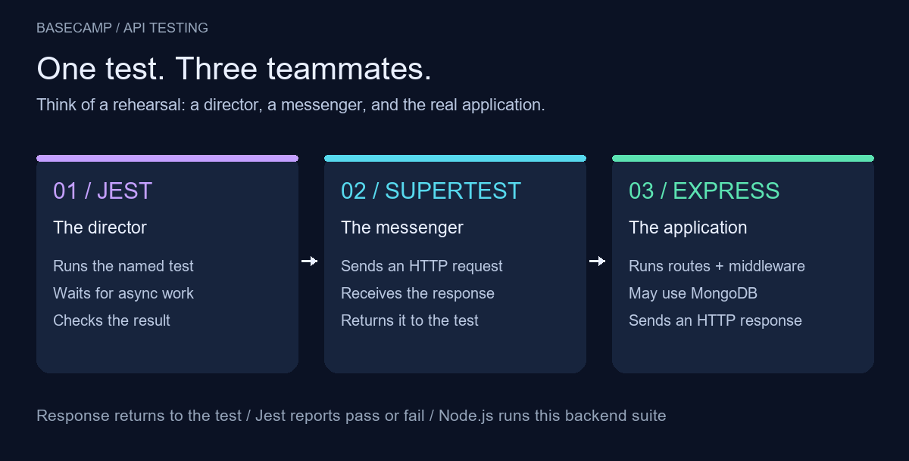
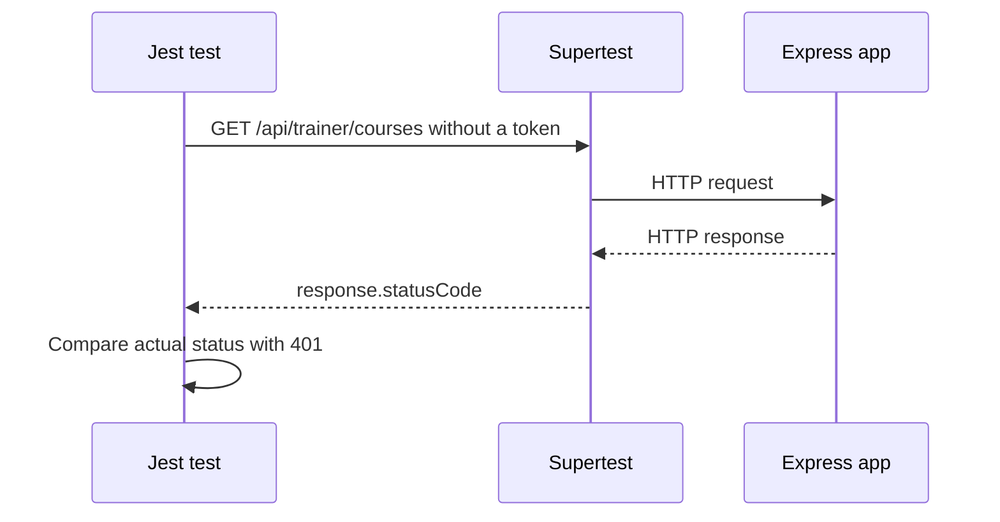
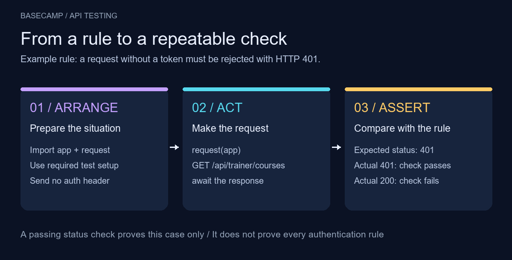

# 🧪 Jest + Supertest: give your API a safety net

> 🟡 **Learning in progress** — the guide and visuals are prepared; understanding and LMS runtime results remain unverified.

> 🧠 **Big idea:** write down a behavior as code, run it automatically, and compare the response with the rule.

## 🎬 Meet the testing team



Think of a rehearsal: **Jest is the director**, **Supertest is the messenger**, and **Express is the application being exercised**. Jest starts the test; Supertest sends a request; Express returns a response; the test checks it. Node.js runs this backend suite. MongoDB participates only when the application or test setup uses it.

| Tool | Responsibility | Recognizable syntax |
| --- | --- | --- |
| Jest | Name and run a case, check values, report the outcome | `test()`, `expect().toBe()` |
| Supertest | Send HTTP requests and expose responses | `request(app).get(...)` |
| Express | Execute middleware and routes | The imported `app` |

Supertest also offers its own `.expect(...)` checks. In the example below, the standalone `expect(...).toBe(...)` comes from Jest.

## 🔐 Start with one LMS rule

**A visitor without a token must not access the trainer's courses.**

The following test already exists in the separate LMS checkout's `tests/auth.test.js`, inspected on 2026-10-22. It is shown for reading; this guide is not a runnable test file.

```js
test('should return 401 when no token is provided', async () => {
    const response = await request(app).get("/api/trainer/courses");

    expect(response.statusCode).toBe(401);
});
```

| Part | Meaning |
| --- | --- |
| `test('...', async () => { ... })` | Give Jest a named case and an asynchronous function to run |
| `request(app)` | Give Supertest the Express application |
| `.get("/api/trainer/courses")` | Send a GET request to that route |
| `await` | Wait for the response before checking it |
| `expect(response.statusCode).toBe(401)` | Fail the check if the actual status is different from `401` |

The surrounding file imports `request` with `require("supertest")`, imports `app` with `require("../app")`, and configures test accounts. Those dependencies and setup matter when running the actual suite.

## 🛤️ Follow the request and response



This diagram shows the response returning to the test. `401` is the **expected rule**, not a newly verified runtime result. Missing authentication should be rejected before the protected controller continues.

## 🧱 Arrange → Act → Assert



1. **Arrange:** prepare the app, test data, and request conditions. Here, the surrounding setup prepares accounts, and the request has no Authorization header.
2. **Act:** send the request and wait for the response.
3. **Assert:** compare the actual result with the expected rule.

The colors separate preparation, action, and verification. The final panel illustrates a passing and failing comparison; neither is a recorded test run.

## 🆚 Where does Postman fit?

| Approach | Useful for |
| --- | --- |
| Send a request in Postman and inspect the response | Explore an endpoint and understand its behavior |
| Save a Jest/Supertest test | Repeat a specific check after code changes |

Postman can also automate checks. The useful distinction here is **manual exploration versus saved, repeatable assertions**, rather than one tool being exclusively manual.

## ⚠️ Green does not mean everything works

- A test passes only the checks you wrote. Checking a status does not check the response body.
- A route returning `401` for every request could pass this test. Add valid-token cases later to check the other side of the rule.
- A database connection or setup failure can prevent the assertion from running. Read where the failure occurred before changing the route.
- Keep test accounts and data separate from real application data.
- For asynchronous tests, return or await the work so Jest waits for it.

## 📖 Book foundation → MERN practice

**Eloquent JavaScript, Chapter 8 — Bugs and Errors, Testing, printed p. 135 (local PDF page 147):** automated tests are programs that check other programs. They make repeated checks practical after changes.

The book demonstrates a small custom `test` function; that function is not Jest. Jest and Supertest are external libraries. In this lesson, that book idea becomes a repeatable HTTP behavior check for an Express application running in Node.js. MongoDB setup supports database-dependent cases; it is not required by every Supertest test.

## 🌐 Web culture

- Name tests after observable behavior: “returns 401 without a token” is more useful than “test 1”.
- Keep a regression test when you fix a bug so later changes can expose its return.
- Run focused checks locally, then the required suite before sharing a change.

## 🧭 Review whenever you are ready

- [Quick review note](../../notes/jest-and-supertest.md)
- [Optional three-question exercise](../../exercises/jest-and-supertest.md)
- [Visual assets and verification](./images/README.md)
- [Official Jest guide](https://jestjs.io/docs/getting-started)
- [Official Supertest documentation](https://github.com/forwardemail/supertest)

> ✅ **Remember:** make a request, observe the response, compare it with a rule.
