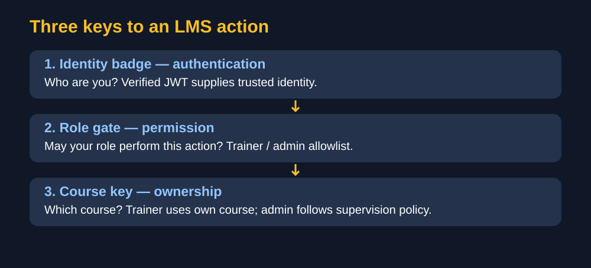
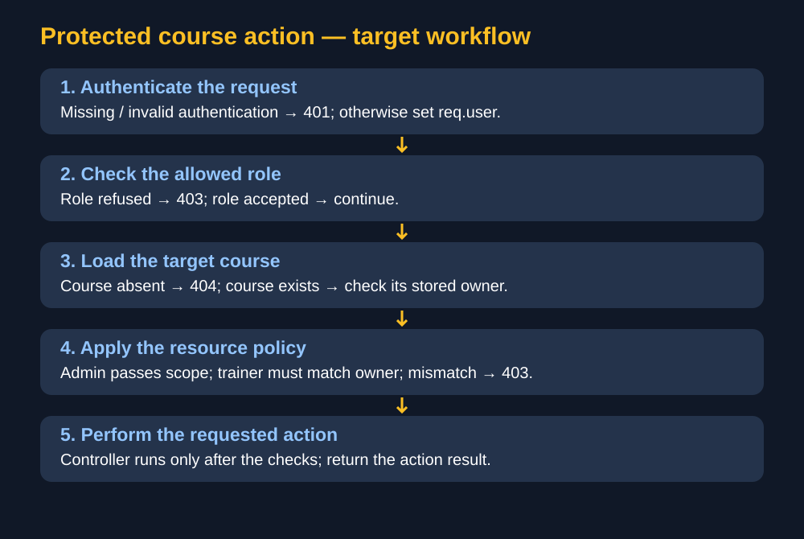
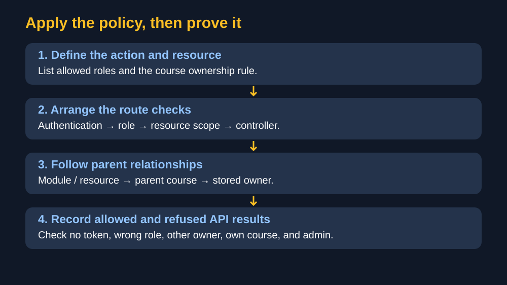

# 🛡️ Roles, permissions, and resource ownership

> 🟡 **In progress** — learner-requested lesson and visual pack prepared. Understanding and protected-route behavior remain unverified.

> 🧠 **Big idea:** authentication identifies the user; authorization decides whether that user may perform this action on this resource.

## 🪪 Three different questions

| Check | Question | LMS example |
| --- | --- | --- |
| Authentication | Who is making the request? | Verify JWT, then set `req.user` |
| Role permission | May this category of user do this action? | Allow `trainer` and `admin` to manage content |
| Ownership | May this particular user access this particular course? | Trainer may manage only their own course |

A permission is an allowed action. A role groups permissions. A course ID identifies the target, but knowing its ID grants no permission.



The badge identifies you, the gate checks your role, and the key represents access to the specific course. This is a memory picture; the policy below is authoritative.

## 📋 What our brief requires

Source: [supplied official brief copy](../../brief-content/source-text.md), sections 1, 2, 3, and 7.

| Actor | Required boundary |
| --- | --- |
| Visitor | Published catalogue; no privileged content management |
| Learner | Learning/enrollment actions subject to enrollment and progression rules |
| Trainer | Manage their own courses, modules, and resources; report on their own learners |
| Admin | Supervision and cross-course access where the brief allows it |

Public registration assigns `learner`. A request body must never let someone appoint themselves `trainer` or `admin`. Trainer creation uses seed/admin or an approved request. Exact route policies must be written explicitly; admin access is not an automatic JavaScript hierarchy.

## 🔄 Workflow for a protected course action



Read from top to bottom. Missing or invalid authentication stops with `401`. An authenticated user without permission stops with `403`. Load the target course; a missing course returns `404`. For the course actions covered by this policy, admin may pass the ownership boundary; trainer must match the stored course owner. A module/resource check follows its parent course. Only then may the controller perform the action. This is the target workflow, not proof that the current routes implement it.

## 🔍 What the current code actually does

Read-only snapshot: `C:/Users/LENOVO/Desktop/fondations_API_LMS`, 2026-10-12.

- `middlewares/authenticate.js` verifies the token and builds `{ id: decoded.sub, role: decoded.role }`.
- `middlewares/authorize.js` already returns middleware that checks an allowed role list.
- `middlewares/errorHandler.js` converts forwarded `statusCode` errors into JSON responses.
- Inspected `routes/courseRoutes.js` and `routes/resourceRoutes.js` contain catalogue GET routes; they do not demonstrate sensitive write-route protection.
- Inspected `models/Course.js` has no owner field. The ownership field and parent lookup still need implementation decisions and verification.
- The token supplies the current middleware's role. If an account is suspended or its role changes after token issuance, current account policy needs a separate trusted lookup/revocation decision; signature verification alone does not refresh that state.

## 🧩 Understand your existing middleware

```js
const authorize = (...allowedRole) => {
  return (req, res, next) => {
    if (!req.user) {
      const error = new Error("Authentication required");
      error.statusCode = 401;
      return next(error);
    }
    if (!allowedRole.includes(req.user.role)) {
      const error = new Error("Forbidden");
      error.statusCode = 403;
      return next(error);
    }
    next();
  };
};
```

- `...allowedRole` collects arguments into an array: `authorize("trainer", "admin")` configures two allowed roles.
- The outer function runs during route setup; the returned function runs for each request. It remembers the configured list.
- `includes(req.user.role)` answers whether the role belongs to that list.
- `next()` continues. `next(error)` forwards a refusal to error handling; `return` prevents continuing afterward.
- This function checks roles only. It never loads a course or compares its owner.

Illustrative route order: `authenticate → authorize("trainer", "admin") → ownership check → controller`. The ownership step is a design requirement, not an existing function name.

## 🧪 What is verified, and what remains

- ✅ Direct checks of the existing `authorize` function: missing user forwards `401`; learner forwards `403`; trainer/admin call `next()` without error. Each case calls it once.
- ⬜ Full HTTP route integration, JSON response checks, database ownership, suspended-account policy, and learner explanation remain pending.
- Earlier roadmap exercises remain unfinished; selecting Concept 5 does not complete them.

## 🛠️ Practical checklist



Use this sequence when preparing FAL-99/FAL-100: define the route's policy, verify authentication, check role, enforce resource scope, then record real API outcomes. A hidden React button is only interface behavior; the backend still checks every request.

## 📖 Eloquent JavaScript foundation

- **Chapter 3, Functions, printed pp. 54–56:** separate responsibilities into named functions; functions can return functions.
- **Chapter 4, Data Structures: Objects and Arrays, printed pp. 61–62 and 69:** object properties hold data; `includes()` checks array membership.
- **Chapter 18, HTTP and Forms, printed pp. 318–319:** requests identify an action and resource; responses communicate status.
- Consulted the local PDF. Express authorization, JWT policy, and Mongoose ownership are practical applications, not tools taught directly by these pages.

## 🧩 MERN connection

- **MongoDB:** stores users and the trusted course ownership relationship; the current Course schema needs that relationship defined.
- **Express / Node.js:** middleware applies decisions before controllers; error handling returns a consistent refusal.
- **React:** may hide unavailable actions, but cannot enforce server permissions.

## ⚠️ Common trap

A trainer role is not permission to edit every course. Never trust `req.body.role` or a client-provided owner ID as authorization evidence. Compare trusted user identity with stored ownership, normalizing database IDs deliberately.

## 🌐 Web culture

Teams commonly call role-based rules RBAC. Ownership adds resource-level checks. Maintain an explicit route/action policy, deny actions without a defined permission, and test both allowed and refused requests.

Express reference: [Using middleware](https://expressjs.com/guide/using-middleware/) and [Error handling](https://expressjs.com/guide/error-handling/).

## 🎯 Understanding checkpoint

Complete the [three-request exercise](../../exercises/roles-and-resource-ownership.md). No full feature implementation is required for this checkpoint.

See the [quick review note](../../notes/roles-and-resource-ownership.md) and [visual tracker](./images/README.md).

> ✅ **Remember:** identify the user, check the action, then check the resource.
