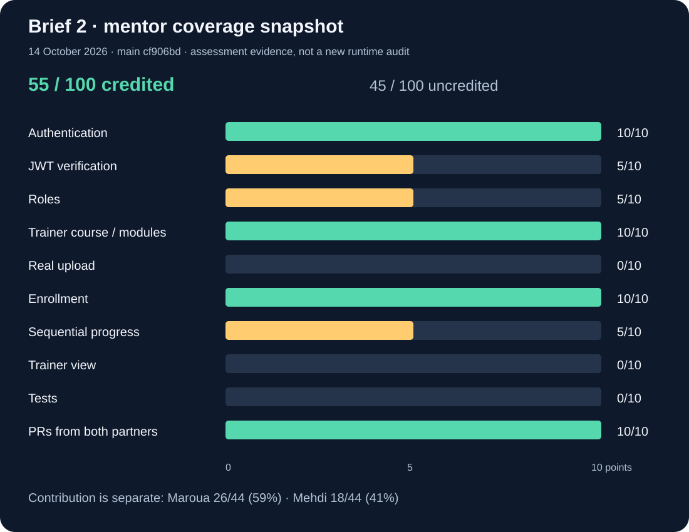
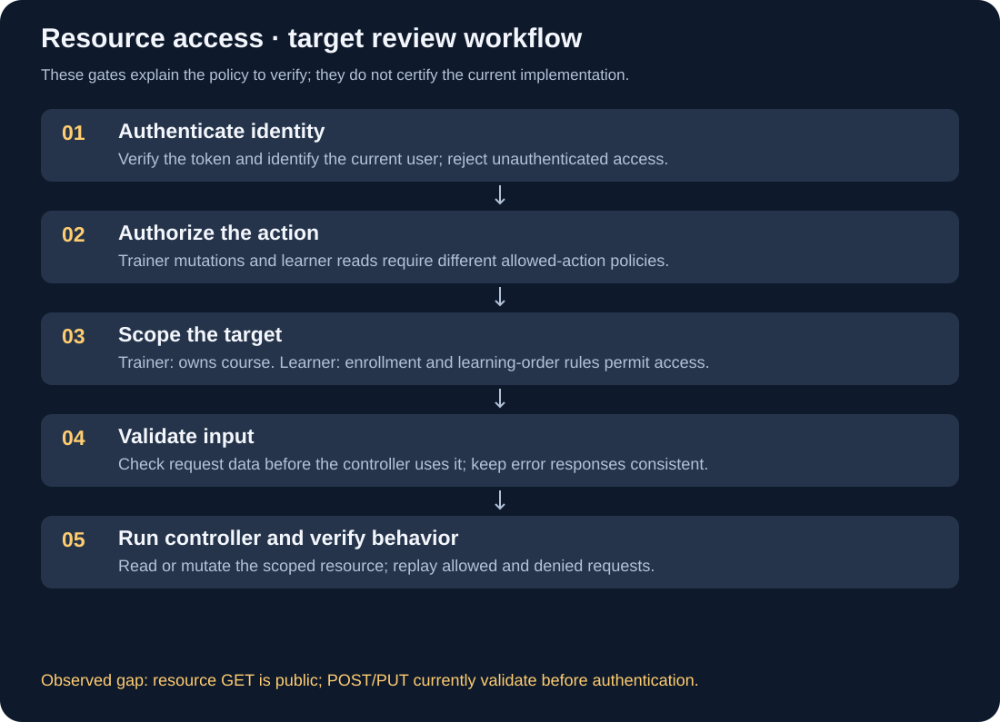
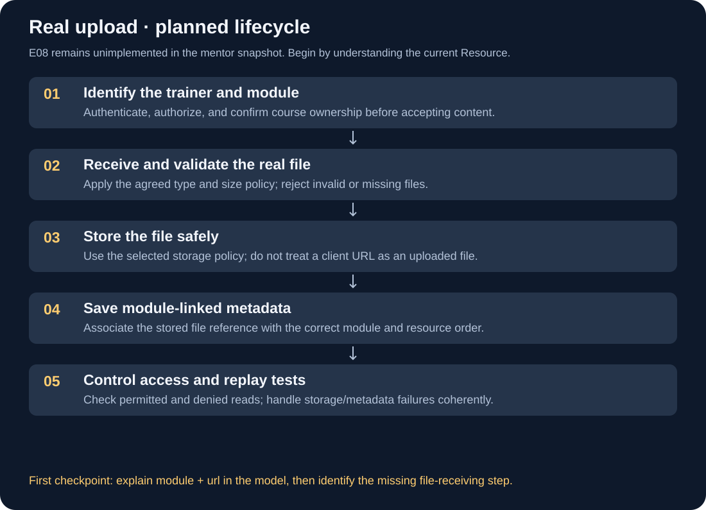

# 📋 Brief 2 — evidence checkpoint, 14 October 2026

> 🟡 **In progress.** This recap collects today's discussions, the mentor's supplied assessment, and a fresh source inspection. It does not certify API behavior or individual mastery.

## 🧭 What moved today

| Area | Evidence collected | Boundary |
| --- | --- | --- |
| Mehdi's work | Today's check-in reports course ownership management (FAL-105), resource management (FAL-107), and protected deletion (FAL-147) | Retrieved from the check-in chat; full runtime checks not repeated here |
| Maroua's work | Today's check-in reports module CRUD/status, Zod validation, and course resume (FAL-39) | Retrieved from the check-in chat; collaborator runtime behavior not independently tested |
| Team delivery | The check-in chat reports PRs #22–#26 merged; mentor screenshot identifies `main cf906bd` | Historical evidence, not a fresh remote-branch audit |
| Mentor feedback | Screenshot dated 14 October, 17:20 UTC: 55/100 coverage | Screenshot read directly; score applies to that snapshot |
| Upload plan | Mehdi agreed to start E08 at 22:00 Africa/Casablanca | A reminder was created in the other chat; execution and delivery not verified |

## 📊 Two different measurements

Each row is worth ten coverage points. This chart reproduces the mentor's snapshot, rather than calculating a new product-completion percentage. The 45 uncredited points are three missing areas (30) plus three partial areas (15).

| Requirement | Mentor score | Essential follow-up |
| --- | ---: | --- |
| Authentication | 10/10 | Preserve and replay registration/login checks |
| Verified JWT | 5/10 | Clarify the mentor's expected claims; an ID in `sub` is not by itself proof of a bug |
| Roles | 5/10 | Demonstrate allowed and denied actions; clarify the missing acceptance evidence |
| Trainer course/module management | 10/10 | Preserve ownership rules and module behavior |
| Real upload | 0/10 | Receive, validate, store, link, and protect a real file |
| Enrollment | 10/10 | Preserve existing rules and test repeat enrollment |
| Sequential progress | 5/10 | Enforce learning order when a resource is consulted |
| Trainer view | 0/10 | Scope enrolled-learner and progress queries to the trainer's course |
| Tests | 0/10 | Replayable critical API scenarios and automated tests |
| PRs from both partners | 10/10 | Keep traceable reviews and delivery evidence |

**Contribution split is separate:** the screenshot credits Maroua with 26/44 weighted contribution points (59%) and Mehdi with 18/44 (41%). JWT, roles, and shared PR credit enter the 55 coverage score but not this contribution denominator. These are neither personal grades nor remaining-work percentages. Do not compare them with the older 7/12 concept-roadmap coverage figure.

## 🔎 Fresh local source review

Read-only inspection of the separate `fondations_API_LMS` checkout found:

- `routes/resourceRoutes.js`: GET `/:id/resources` has no authentication middleware.
- POST and PUT currently run body validation **before** `authenticate` and `authorize(roles.TRAINER)`. The intended review order is authentication → authorization → input validation → controller.
- DELETE has authentication and trainer-role checks. Its documentation explicitly says course ownership is not checked.
- `getResourcesByModule` filters by module ID and sorts by order. Sorting results does not enforce access or progression.
- `models/Resource.js` stores `module`, `type`, `url`, and `order`. `createResource` saves those values; this is URL-based resource creation, not evidence of real file upload.
- `models/Course.js` now has a `trainer` reference. The older note saying ownership has no schema field is outdated; a field's presence still does not prove every endpoint checks it.

No API files were changed. No database, HTTP, Docker, or role/ownership runtime test was run in this consolidation. Local Git inspection of the LMS checkout was denied, so its current branch/merge state was not independently confirmed.

## 🛡️ Resource access: the decisions to keep separate

This is the **target review workflow**, not a claim that all gates are implemented. A trainer role permits an action; ownership limits its target. Learner reads need the appropriate enrollment and progression checks, rather than a trainer-only role restriction. Exact response policies remain defined by the API contract.

## 📦 Upload: prepare one checkpoint

This picture shows the required lifecycle. It is a planning visual, not a completed upload lesson or implementation. Exact type/size limits and storage choices must come from the brief and project decisions; they are not invented here. If saving metadata fails after storage, the implementation needs a cleanup policy for the stored file.

**One next mission:** inspect `models/Resource.js`, `routes/resourceRoutes.js`, and `controllers/resourceController.js`, then explain where the module ID and URL are stored and why saving a URL is different from receiving a file. **Completion check:** Mehdi gives those three answers before implementation starts. Earlier roles, JWT, and non-regression understanding checks stay open.

## 🔗 Sources and related notes

- Codex chat **Schedule daily board check-in**, 14 October turns: mentor screenshot, pair update, E08 choice, and 22:00 agreement.
- Codex chat **Add resource CRUD and course filters**, 14 October turns: middleware invocation, route review, and GET access discussion.
- Fresh local source files listed above; no secrets or account credentials collected.
- [Roles and ownership quick note](./roles-and-resource-ownership.md) and [existing concept lesson](../concepts/roles-and-resource-ownership/).
- [Student-life and session recap](../../../../../../sessions/history/2026-10-14-brief-and-student-life.md).

> ✅ **Remember:** discussed → saved → implemented → tested are different states. Record the evidence before changing the status.
