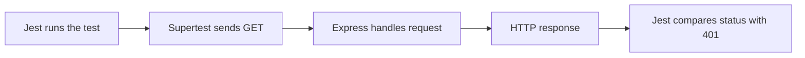

# 🧪 Jest and Supertest — quick review

> 🟡 **In progress** — explanation prepared; learner prediction and understanding check pending.

> 🧠 **Big idea:** an automated test sends an action to your code and checks whether the result matches a rule.

## 🔑 Two tools, two jobs

- **Jest** runs the test and reports success or failure. `test()` names a case; `expect(value).toBe(expected)` checks a value.
- **Supertest** sends HTTP requests to the Express app and gives the test access to the response.
- **Express** handles the request using the application's real routes and middleware.



The arrows show one request and its response. This is a reading aid, not evidence of an executed test. Open the [illustrated lesson and visual pack](../concepts/jest-and-supertest/) for the complete repository guide.

## 🔍 Our actual LMS example

Source inspected read-only on 2026-10-22: `C:/Users/LENOVO/Desktop/fondations_API_LMS/tests/auth.test.js`.

```js
test('should return 401 when no token is provided', async () => {
    const response = await request(app).get("/api/trainer/courses");
    expect(response.statusCode).toBe(401);
});
```

- `request` comes from Supertest; `app` is the imported Express app.
- `await` waits for the response before the comparison.
- **Arrange:** the surrounding file imports the app and request helper and configures test accounts.
- **Act:** send the GET request without an Authorization header.
- **Assert:** compare the response status with `401`.
- Source reading only: this checkpoint did not run the LMS suite or verify the endpoint.

## 📖 Eloquent JavaScript foundation

- **Chapter 8 — Bugs and Errors, Testing, printed p. 135** (local PDF page 147).
- Automated tests are programs that check other programs; they repeat checks after changes.
- A passing test supports only the situations and assertions it actually checks.
- The book's small `test` helper is an example function, not Jest. Jest and Supertest are external libraries.

## 🧩 MERN connection

- **Node.js:** runs this backend test suite.
- **Express:** receives the request; its response is what the test checks.
- **MongoDB:** the surrounding suite uses account/database setup; that setup must work before dependent tests can run. Database testing is a later checkpoint.

## ⚠️ Common trap

- A passing `401` assertion does not prove the entire authentication system works.
- A test named “without token” can pass for the wrong reason if the application returns `401` for every request. Later tests need valid-token cases too.

## 🌐 Web culture

- Teams keep repeatable tests beside their project and rerun them after changes.
- Test the expected behavior, not just whether the server starts.
- Keep test data isolated from real application data.

## 🔗 Related learning

- [Illustrated Jest and Supertest lesson](../concepts/jest-and-supertest/).

- [Your three-question checkpoint](../exercises/jest-and-supertest.md).
- [Official Jest introduction](https://jestjs.io/docs/getting-started).
- [Official Supertest examples](https://github.com/forwardemail/supertest).

> ✅ **Remember:** Supertest makes the request; Jest runs the case and checks the answer.
