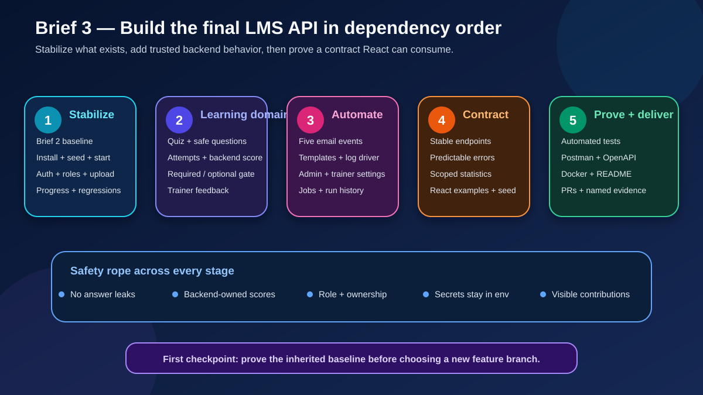

# 🔎 Brief 3 Analysis

> 🧠 **Big idea:** this is not only a feature brief. It is a final-delivery brief: inherit Brief 2 safely, add the missing backend capabilities, and give React a stable, tested contract.

## 🧩 What the brief is really asking for

| Track | Required outcome | Main risk |
| --- | --- | --- |
| Stability | One common squad baseline; regressions fixed or tracked | Building new work on different or broken branches |
| Quiz learning flow | Secret answers, backend score, attempts, required/optional progression | Trusting learner-supplied score or leaking answers |
| Feedback | Trainer-owned course feedback, admin override, learner privacy | Role check without ownership or target-user scope |
| Notifications | Five email situations, two templates, safe dev mode | Secrets in Git or email side effects during tests |
| Configuration | Admin settings plus trainer subscriptions and course scope | Mixing public settings with environment secrets |
| Jobs | Configurable schedules, traceable runs, manual trigger | Duplicate execution and unprovable job history |
| React contract | Stable endpoints, errors, demo data, statistics | Frontend depending on changing or inconsistent JSON |
| Delivery quality | Tests, API collection, OpenAPI, README, seed, Docker, PR reviews | A demo that works only on one machine |

## 🧭 Dependency map

The route moves left to right. Security, ownership, secret handling, predictable errors, and contribution evidence apply to every stage rather than being postponed to the end.

## 🔍 Current project baseline

The related checkout `C:\Users\LENOVO\Desktop\fondations_API_LMS` was inspected read-only on 2026-10-19. Git metadata and runtime behavior were not available in this intake, so “present” means **found in source**, not **verified working**.

### ✅ Present in source

- Express app with separate routes, controllers, models, services, middleware, validators, and Swagger setup.
- Mongoose models for users, courses, modules, resources, enrollments, module progress, and resource progress.
- JWT authentication, role middleware, enrollment checks, upload middleware, and some ownership checks.
- Course, module, resource, enrollment, progress, resume, and trainer-progress code.
- Multer upload support, seed script, Dockerfile, Docker Compose, Jest, Supertest, and two automated test files.

### 🟡 Must be verified or corrected first

- Clean installation, environment setup, API startup, MongoDB connection, and seed behavior.
- The Brief 2 regression set: auth, roles, enrollments, course ownership, resources, upload, and sequential progress.
- Consistency of response bodies, error bodies, status codes, validation order, and Swagger descriptions.
- Ownership on every trainer route; one inspected resource-delete description still states that course ownership is not checked.
- Test coverage beyond authentication and role middleware.
- Docker and API docs as a fresh-clone experience.

### ⬜ Genuinely new in the inspected source

- `Quiz`, `QuizAttempt`, and `Feedback` models and routes.
- Backend quiz scoring and the required/optional progression gate.
- Email service, learner/trainer HTML templates, and five event integrations.
- Admin notification/job settings, trainer summary preferences, and job-run history.
- Scheduled jobs and manual job triggers.
- Dedicated React statistics endpoints and a documented React contract.

## 🔴 Highest-risk rules

1. **Never return correct quiz answers to a learner before or during submission.** Public quiz JSON must use a safe projection.
2. **Never accept a score from the client.** The backend compares submitted choices with stored answers and saves the calculated result.
3. **Required and optional quizzes change progression differently.** This belongs in one explicit backend rule, not scattered controller conditions.
4. **Role is not ownership.** A trainer must be limited to their courses; a learner must be limited to their attempts and feedback.
5. **Settings are not secrets.** Frequencies and feature toggles may live in application data; SMTP passwords and tokens stay in environment variables.
6. **Jobs must be safe to repeat.** A retry or manual trigger should not create duplicate reminders or summaries without traceable evidence.
7. **React needs a contract, not implementation knowledge.** Stable paths, parameters, response shapes, error shapes, and examples must be documented.

## 📦 Deliverable groups

### Product behavior

- Quiz, attempts, scoring, progression, feedback, emails, configuration, jobs, and statistics.

### API proof

- Focused automated tests plus an executable Postman/Insomnia collection.
- OpenAPI documentation, predictable errors, and a React-facing contract.

### Reproducible delivery

- Demo seed, `.env.example`, API + MongoDB Docker Compose, final README, PRs, reviews, Jira ownership, and visible individual contributions.

## 📖 Eloquent JavaScript foundations

The book does not teach Mongoose, cron libraries, SMTP providers, Swagger, or Docker directly. It supplies the JavaScript foundations:

- Chapter 4, printed pp. 58–82: objects and arrays for nested quiz and attempt data.
- Chapter 5, printed pp. 84–98: transformations and aggregation for scores and statistics.
- Chapter 8, printed pp. 132–147: automated tests, debugging, and deliberate error handling.
- Chapter 10, printed pp. 172–184: module interfaces for services, repositories, templates, and providers.
- Chapter 11, printed pp. 185–206: promises and asynchronous work for database, email, and job flows.
- Chapter 18, printed pp. 317–339: HTTP methods, headers, responses, and client-server contracts.
- Chapter 20, printed pp. 361–378: Node.js servers, asynchronous I/O, HTTP behavior, and repeatable scripts.

## ⚠️ Open source gaps

- Import the missing official PDF continuation before freezing job endpoints or acceptance criteria.
- Confirm squad name, members, and responsibility split.
- Confirm the shared repository and the exact baseline branch/commit.
- Confirm provider choice and the allowed job frequencies.
- Confirm the expected statistics and React response shapes.

## 🎯 Recommended first checkpoint

Create a small baseline matrix for startup, seed, auth, roles, enrollments, resources, upload, and progression. Run nothing destructive; record each item as pass, fail, or unknown with one reproducible check.
